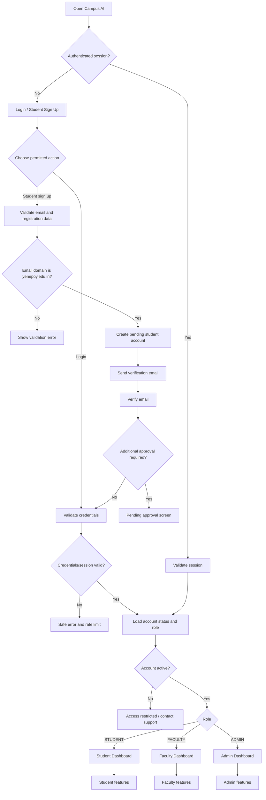
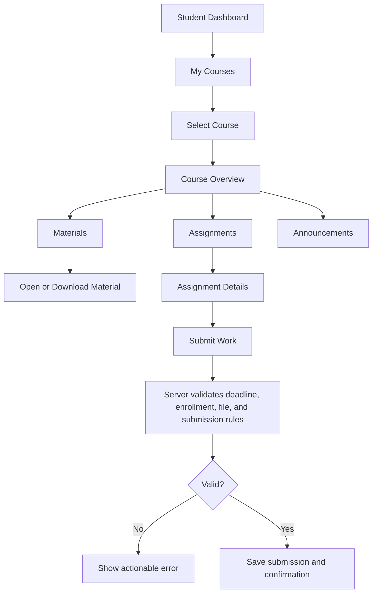
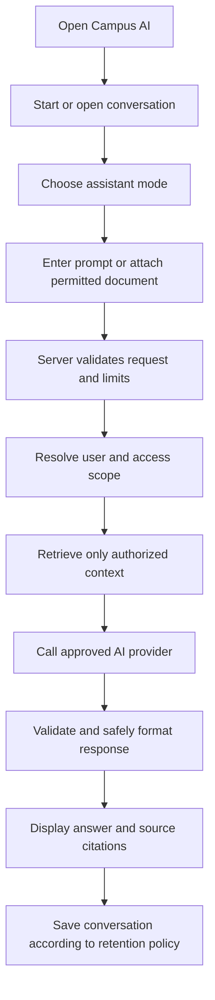
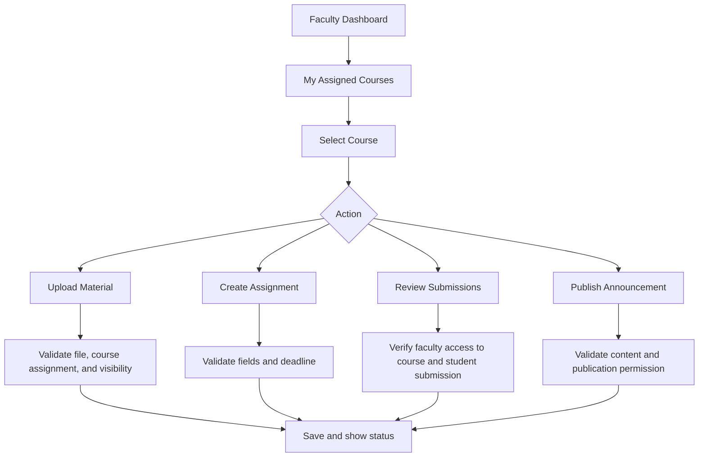
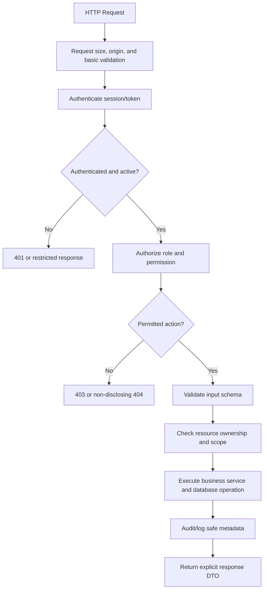

# Campus AI — Application Flow

**Institution:** Yenepoya School of Technology (YSET)  
**Product:** Campus AI  
**Document type:** Application flow and navigation specification  
**Audience:** Product, UX/UI, frontend, backend, QA, and security teams  
**Status:** Implementation guide; align final behavior with approved university policies.

---

## 1. Purpose

This document describes how users enter Campus AI, authenticate, reach role-specific dashboards, navigate core features, and move through key workflows. It also defines the security checks that must happen behind the UI.

Campus AI has three roles:

- `STUDENT`
- `FACULTY`
- `ADMIN`

The application must not rely on the UI alone to enforce permissions. The backend is authoritative for identity, roles, ownership, and access to every resource.

## 2. High-level application flow



### Authentication policy

- Student self-registration requires the exact email domain `@yenepoy.edu.in`, validated on the server after normalization.
- Domain validation must compare the complete email domain, not use a substring check.
- Email verification proves access to the mailbox; it does not independently prove enrollment if the university requires roster verification.
- Faculty and admin accounts are created through approved invitation/provisioning workflows. Do not expose public role selection.
- All protected routes require a valid session and an active account.
- The server determines the role. Never trust a role supplied by the browser.

## 3. Public routes

| Route | Purpose | Access |
|---|---|---|
| `/` | Product entry or redirect | Public |
| `/login` | Sign in | Public |
| `/signup` | Student self-registration | Public, student only |
| `/verify-email` | Verify email token | Token-bound |
| `/forgot-password` | Request password reset | Public, rate-limited |
| `/reset-password` | Set a new password using a valid token | Token-bound |
| `/unauthorized` | Access denied page | Public |
| `/account-restricted` | Suspended, pending, or disabled account guidance | Authenticated or token-bound as appropriate |

After successful login, redirect users to the landing page associated with their server-resolved role. If an authenticated user visits `/login`, redirect them to their authorized dashboard.

## 4. Shared authenticated application shell

All roles use a consistent design system and shared shell:

- Institution/product identity: **Yenepoya School of Technology (YSET) · Campus AI**
- Role-appropriate sidebar navigation.
- Top bar with page title/breadcrumbs where useful.
- Notifications.
- Profile menu and logout.
- Search only where the user has permission to search.
- Loading, empty, error, and permission-denied states.
- Responsive mobile navigation.

Navigation items are not security controls. Every route and every backend request must enforce authorization independently.

## 5. Student flow

### Student navigation

```text
/student
├── /dashboard
├── /courses
│   └── /:courseId
│       ├── /materials
│       ├── /assignments
│       └── /announcements
├── /materials
├── /assignments
│   └── /:assignmentId
├── /timetable
├── /announcements
├── /notifications
├── /ai
│   ├── /new
│   └── /:conversationId
├── /profile
└── /settings/security
```

### Student dashboard to task flow

1. Student signs in.
2. Server validates the session and account status.
3. Student dashboard loads only the student's authorized data.
4. Student opens a course, assignment, material, timetable, or announcement.
5. The API checks enrollment, visibility, and ownership as relevant.
6. The UI displays the authorized resource and its current state.
7. Any mutation, such as submitting work, is validated and recorded server-side.

### Course flow



### Student assignment submission flow

1. Open **Assignments** or a course's assignment tab.
2. Select an assignment.
3. View instructions, deadline, allowed file types, and submission status.
4. Select a file or enter the required submission content.
5. Review the submission and submit.
6. The server validates identity, enrollment, assignment state, deadline policy, file limits, and duplicate submission behavior.
7. Store the submission and return a receipt/status.
8. Show the submission timestamp and current status.
9. Allow replacement/resubmission only if the configured assignment policy permits it.

### Student AI assistant flow



**Assistant modes**
- `GENERAL`: general study support within product policy.
- `MY_DOCUMENTS`: only the current user's permitted documents.
- `MY_COURSES`: materials and content from courses the student is authorized to access.
- `UNIVERSITY_KNOWLEDGE`: approved university-wide sources and policies.

Rules:
- The client must not choose an arbitrary user ID or retrieval scope.
- Authorization filters must be applied before retrieved text is added to the model context.
- Re-check authorization before returning source snippets or links.
- AI output must not grant access or perform privileged actions.
- Show citations for university and document-based answers where available.
- If reliable evidence is missing, say so instead of inventing a policy or citation.
- Show safe error and retry states if the provider fails or limits are reached.

## 6. Faculty flow

### Faculty navigation

```text
/faculty
├── /dashboard
├── /courses
│   └── /:courseId
│       ├── /students
│       ├── /materials
│       ├── /assignments
│       ├── /submissions
│       └── /announcements
├── /timetable
├── /notifications
├── /profile
└── /settings/security
```

### Faculty course workflow



Faculty can:
- View assigned courses and authorized enrolled students.
- Upload and manage materials within assigned courses.
- Create and publish assignments.
- Review submissions and provide feedback/grades where authorized.
- Publish course announcements.
- Use AI features only with data the faculty member is authorized to access.

The backend must confirm course assignment and resource scope for every operation. A faculty member must not gain access by guessing another course's ID.

## 7. Administrator flow

### Admin navigation

```text
/admin
├── /dashboard
├── /users
│   └── /:userId
├── /invitations
├── /departments
├── /courses
├── /faculty
├── /students
├── /announcements
├── /knowledge-base
│   └── /:documentId
├── /ai-usage
├── /audit-logs
└── /settings
```

### Administrative workflows

**Provision faculty/admin**
1. Authorized administrator opens Invitations or User Management.
2. Selects the permitted role and enters the intended institutional identity.
3. Server checks administrator permissions and the allowed email domain.
4. Server creates an expiring, single-use invitation and records an audit event.
5. Invitee verifies identity and completes the approved setup.
6. Role is assigned only through the authorized server-side workflow.

**Manage users**
1. Search/filter a permitted user list.
2. Open a user detail page.
3. Review only fields the administrator is authorized to see.
4. Change status or role only if permitted and, where required, with a reason/confirmation.
5. Revoke sessions when suspending or disabling an account.
6. Record the action in an audit log.

**Manage courses and departments**
1. Create or edit a record.
2. Validate unique codes, required fields, and related entities.
3. Check dependencies before archiving/deleting.
4. Persist through a transaction where multiple records must change together.
5. Show a clear success or error state.

**Manage university knowledge**
1. Upload an approved source document.
2. Assign visibility and source metadata.
3. Scan/validate and process the file in a controlled worker.
4. Extract text and index it.
5. Display `Processing`, `Ready`, `Failed`, or `Archived`.
6. Publish only when processing and access metadata are valid.
7. On deletion or visibility change, update the original file, extracted text, embeddings, caches, and retrieval access according to policy.

## 8. Route protection and backend request flow

Every protected API operation follows this sequence:



Do not use this diagram to imply that one middleware check replaces resource-level authorization. Ownership and scope must be checked for the actual resource involved.

## 9. Account and session edge cases

- **Invalid login:** show a generic error; apply rate limits.
- **Unverified email:** show verification guidance; do not grant normal access.
- **Pending approval:** show a pending state and support instructions.
- **Suspended/disabled account:** deny access and revoke sessions as policy requires.
- **Expired session:** redirect to login; preserve only safe navigation intent.
- **Password reset:** use a short-lived, single-use token and revoke relevant sessions according to policy.
- **Role changed:** refresh permissions or revoke sessions so old privileges do not remain active.
- **Invitation expired/reused:** reject and provide a safe path to request a new invitation.
- **Deleted/archived resource:** show a non-disclosing unavailable state where appropriate.
- **API/provider outage:** show a clear error and retry only safe/idempotent operations.

## 10. Route and permission matrix

| Capability | Student | Faculty | Admin |
|---|---|---|---|
| View own profile | Yes | Yes | As permitted |
| Browse enrolled courses | Yes | Assigned courses | All within admin scope |
| View course materials | Published/authorized | Assigned course scope | Administrative scope |
| Upload course materials | No, unless explicitly supported | Assigned courses | As permitted |
| Create assignments | No | Assigned courses | As permitted |
| Submit own assignment | Yes | No | No, unless explicitly supported |
| Review/grade submissions | No | Assigned courses | Only if explicitly authorized |
| Manage user roles | No | No | Granular permission required |
| Provision faculty/admin | No | No | Explicit permission required |
| Manage university knowledge | No | Only if granted | Explicit permission required |
| View audit logs | No | No by default | Explicit permission required |
| Use AI assistant | Authorized modes | Authorized work scopes | Authorized administrative scope |

This is a baseline matrix. Final permissions must be explicitly documented and enforced by the backend.

## 11. Navigation and URL rules

- Use a consistent prefix per role: `/student/*`, `/faculty/*`, `/admin/*`.
- Use a shared unauthorized page rather than silently showing protected content.
- Do not treat obscured or unknown URLs as protected by obscurity; enforce server-side permissions.
- Deep links must re-run authentication and authorization checks.
- After login, redirect only to a validated internal path; reject untrusted external redirect destinations.
- Preserve a user's intended internal destination only when safe and authorized.
- Use stable resource IDs, but never assume an ID is secret or grants access.
- Navigation should reflect permissions but must not be the only permission enforcement mechanism.

## 12. UX state requirements

Every major route should define:
- Loading state.
- Empty state with an appropriate next action.
- Validation errors.
- Server/API error state.
- Permission-denied or unavailable state.
- Success confirmation for mutations.
- Confirmation for destructive/high-impact actions.
- Mobile-responsive behavior.
- Keyboard and screen-reader support.

Do not show fake counts, fake grades, fabricated AI citations, or fake system-health status in production. Mark sample data clearly in prototypes.

## 13. Critical acceptance tests

Before release, verify at minimum:

- [ ] A non-`yenepoy.edu.in` email cannot self-register.
- [ ] Domain checks reject lookalike domains and malformed addresses.
- [ ] Students cannot select or assign themselves faculty/admin roles.
- [ ] Unverified, suspended, and disabled accounts cannot use protected features.
- [ ] A student cannot read another student's private chat, profile, submission, or uploaded document.
- [ ] Faculty cannot access courses or submissions outside their assigned scope.
- [ ] Guessing a resource ID does not bypass authorization.
- [ ] Admin actions are permission-checked and audited.
- [ ] AI retrieval cannot include content outside the caller's authorized scope.
- [ ] Deleting/revoking a document prevents future retrieval according to the documented deletion policy.
- [ ] Uploads enforce file type, size, and processing limits.
- [ ] Session expiry, logout, password reset, and role changes revoke or refresh access correctly.
- [ ] API errors do not expose secrets, stack traces, or private records.
- [ ] Core flows work at desktop and mobile sizes.

## 14. Implementation sequence

1. Establish app shell, route structure, design tokens, and shared components.
2. Implement authentication, email verification, account status, and role resolution.
3. Add server-side authorization helpers and tests before building protected features.
4. Build the student dashboard, courses, materials, and assignments.
5. Build faculty course, material, assignment, and submission workflows.
6. Build admin user, department, course, and invitation workflows.
7. Add secure uploads and the university knowledge base.
8. Add the AI assistant with authorization-aware retrieval and citations.
9. Add audit logs, monitoring, rate limits, and abuse controls.
10. Complete accessibility, security, integration, and end-to-end tests.
11. Deploy to staging, validate migrations and backups, then release through the approved production process.

---

**Core rule:** Every UI flow must have a corresponding server-side permission check, validated input contract, defined error state, and test for unauthorized access.
