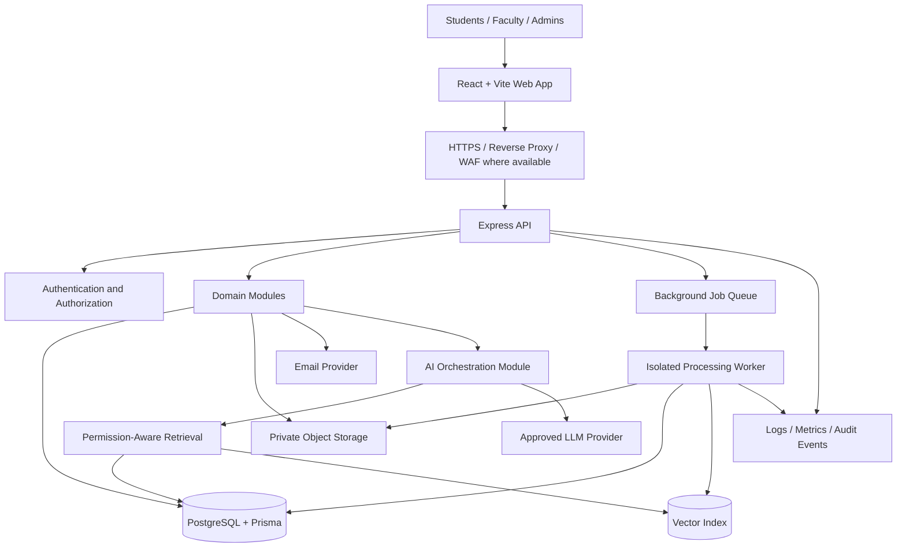
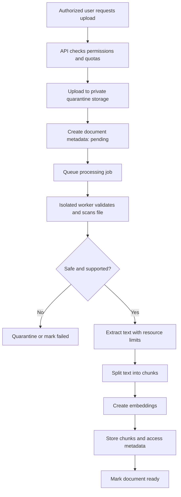
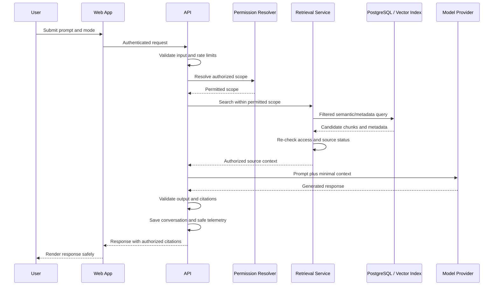
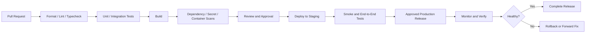

# Campus AI — System Architecture

**Institution:** Yenepoya School of Technology (YSET)  
**Product:** Campus AI  
**Document type:** System architecture and technical design  
**Audience:** Engineering, security, DevOps, QA, and product teams  
**Status:** Proposed baseline; confirm deployment, university policy, and data-processing requirements before production.

---

## 1. Purpose and architectural goals

Campus AI is a university-facing web application for students, faculty, and administrators. It combines academic workflows with an AI assistant that can answer questions using authorized course materials and approved university knowledge.

The architecture should prioritize:

1. **Security by default:** server-side authorization and resource-level access control.
2. **Privacy:** minimize personal data and keep private documents scoped to authorized users.
3. **Maintainability:** clear module boundaries and stable interfaces.
4. **Reliability:** bounded timeouts, retries, resource usage, and graceful degradation.
5. **Extensibility:** allow AI providers, object storage, email delivery, and deployment infrastructure to change behind adapters.
6. **Cost control:** limits on AI tokens, file processing, storage, and concurrent jobs.
7. **Observability:** structured logs, metrics, traces where appropriate, audit events, and operational runbooks.

Start with a **modular monolith** rather than microservices. Split services only when a concrete scaling, security isolation, team ownership, or reliability requirement justifies the operational complexity.

## 2. Technology baseline

| Layer | Proposed technology | Responsibility |
|---|---|---|
| Web frontend | React + Vite + TypeScript | Role-specific UI and client-side interaction |
| Styling | Tailwind CSS + shared component system | Design tokens, responsive layouts, reusable UI |
| API | Node.js + Express + TypeScript | Authentication, authorization, validation, business workflows |
| API contracts | OpenAPI + validated schemas | Stable request/response contracts |
| Relational database | PostgreSQL | Users, roles, courses, assignments, chats, metadata, audit references |
| ORM and migrations | Prisma | Typed data access and versioned schema migrations |
| File storage | Private S3-compatible object storage | Uploaded PDFs and learning materials |
| Background jobs | Queue + isolated worker process, when needed | File scanning, parsing, embedding, indexing, notifications |
| AI integration | Server-side provider adapter | Model calls, budgets, timeouts, retries, provider abstraction |
| Retrieval | PostgreSQL with a vector extension or a dedicated vector store if justified | Permission-aware semantic retrieval |
| Email | Approved transactional email provider | Verification, invitations, password recovery |
| Authentication | Secure server-side sessions or short-lived access tokens plus rotating refresh sessions | Login state and session lifecycle |
| Deployment | Containers or managed application runtime | Reproducible releases and environment separation |
| Observability | Structured logs, metrics, alerts, error tracking | Diagnosis and operational health |

This is a recommended starting point, not a requirement to adopt every component on day one. Avoid adding Redis, a dedicated vector database, a separate search service, or microservices until the workload and operational need are demonstrated.

## 3. High-level system diagram



### Trust boundaries

- The browser is untrusted. Client-side role checks and hidden UI controls are not security boundaries.
- The public internet and reverse proxy are outside the application trust boundary.
- The API is the policy enforcement point for user identity, roles, resource ownership, and data scope.
- The database, object storage, job queue, and model provider are separate trust boundaries with separate credentials and failure modes.
- Uploaded files, extracted text, retrieved passages, and model output are untrusted content.
- AI providers receive only the minimum approved context needed for a request.

## 4. Deployment topology

### Development

- Local frontend and API processes.
- Local or isolated development PostgreSQL database.
- Mock email/AI provider where practical; use real provider credentials only in a secure local environment.
- Test documents and synthetic accounts, not production student data.
- `.env.example` committed; actual secrets excluded from version control.

### Staging

- Separate database, object storage bucket, credentials, and AI/email configuration from production.
- Production-like migrations, authorization policies, rate limits, and file-processing controls.
- Synthetic or approved de-identified data.
- End-to-end tests, smoke tests, and release verification.

### Production

- HTTPS at the edge.
- Frontend served as static assets through a CDN or managed web host where appropriate.
- API deployed as a managed service or container workload.
- PostgreSQL on a private network with managed backups and TLS where supported.
- Private object storage with encryption and restricted service access.
- Background worker isolated from public inbound traffic.
- Secrets supplied through a managed secret store or protected runtime configuration.
- Centralized monitoring and alerting.
- Separate, tightly controlled administrative access.
- Defined backup, restore, rollback, and incident response procedures.

Do not assume that a specific cloud provider, region, or data-residency arrangement has been approved. Confirm these with the institution before production deployment.

## 5. Frontend architecture

Suggested structure:

```text
apps/web/
├── src/
│   ├── app/
│   │   ├── router/
│   │   ├── providers/
│   │   └── layouts/
│   ├── components/
│   │   ├── ui/
│   │   └── shared/
│   ├── features/
│   │   ├── auth/
│   │   ├── student-dashboard/
│   │   ├── courses/
│   │   ├── materials/
│   │   ├── assignments/
│   │   ├── faculty/
│   │   ├── admin/
│   │   ├── notifications/
│   │   └── campus-ai/
│   ├── lib/
│   │   ├── api-client.ts
│   │   ├── validation.ts
│   │   └── error-handling.ts
│   ├── hooks/
│   ├── types/
│   └── main.tsx
├── public/
└── tests/
```

### Frontend responsibilities

- Render role-appropriate pages and navigation.
- Collect input and provide immediate usability validation.
- Call the API through a centralized typed client.
- Display loading, success, empty, error, and permission-denied states.
- Render assistant responses and citations safely.
- Never hold database credentials, model provider keys, signing keys, or privileged service secrets.
- Never be the final authority for role checks, ownership, course enrollment, or document access.
- Avoid long-lived authentication credentials in browser storage.

### Frontend routing

Use consistent route prefixes:

- `/student/*`
- `/faculty/*`
- `/admin/*`

Route guards improve UX but do not replace API authorization. Deep links must be checked by the server when data is requested.

## 6. Backend architecture

Use a modular monolith with explicit module boundaries.

Suggested structure:

```text
apps/api/
├── src/
│   ├── app.ts
│   ├── server.ts
│   ├── config/
│   ├── middleware/
│   │   ├── authenticate.ts
│   │   ├── authorize.ts
│   │   ├── validate-request.ts
│   │   ├── rate-limit.ts
│   │   └── error-handler.ts
│   ├── modules/
│   │   ├── auth/
│   │   ├── users/
│   │   ├── departments/
│   │   ├── courses/
│   │   ├── materials/
│   │   ├── assignments/
│   │   ├── submissions/
│   │   ├── announcements/
│   │   ├── notifications/
│   │   ├── conversations/
│   │   ├── knowledge-base/
│   │   ├── ai/
│   │   └── audit/
│   ├── infrastructure/
│   │   ├── database/
│   │   ├── object-storage/
│   │   ├── email/
│   │   ├── ai-provider/
│   │   ├── queue/
│   │   └── observability/
│   └── shared/
│       ├── errors/
│       ├── schemas/
│       └── types/
├── prisma/
│   ├── schema.prisma
│   └── migrations/
└── tests/
```

### Request handling sequence

1. Apply request size limits and trusted-proxy configuration.
2. Assign or propagate a correlation ID.
3. Authenticate the session or token.
4. Confirm account status.
5. Validate request parameters, body, and query.
6. Authorize the requested action.
7. Query resources within the caller's permitted scope.
8. Execute domain logic and database transactions as required.
9. Emit safe audit events and operational telemetry.
10. Return an explicit response DTO through centralized error handling.

Do not rely on a generic role middleware alone. Each operation must enforce resource ownership and scope.

## 7. Domain module responsibilities

| Module | Owns |
|---|---|
| Auth | Login, logout, email verification, password reset, session/refresh lifecycle |
| Users | Profiles, account status, role assignment through approved workflows |
| Departments | Department records and relationships |
| Courses | Course metadata, faculty assignments, enrollment and visibility |
| Materials | Material metadata, upload lifecycle, download authorization |
| Assignments | Assignment definitions, deadlines, publication state |
| Submissions | Student submissions, review state, feedback, grades |
| Announcements | Drafting, publishing, audience scope |
| Notifications | In-app notifications and delivery state |
| Conversations | Chat history, ownership, conversation metadata |
| Knowledge Base | Approved university documents, versioning, visibility, processing state |
| AI | Prompt orchestration, retrieval coordination, provider budgets and safe output handling |
| Audit | Security-relevant and administrative event records |

Modules may use shared infrastructure, but one module should not directly mutate another module's data without an explicit domain interface or approved transaction boundary.

## 8. Authentication and authorization architecture

### Account roles

- `STUDENT`
- `FACULTY`
- `ADMIN`

### Student signup

1. Validate email syntax and normalize it consistently.
2. Enforce the complete domain `yenepoya.edu.in` on the server.
3. Create a pending student account with a fixed student role only.
4. Send a single-use, expiring email verification link.
5. Verify mailbox ownership.
6. Apply university roster or approval checks if required.
7. Activate the account only when all required checks pass.

Email domain membership alone must not be treated as proof of enrollment if the institution requires stronger verification.

### Faculty/admin provisioning

- Use approved invitation or provisioning workflows.
- Do not expose public role selection.
- Require explicit permission to assign privileged roles.
- Record role changes and provisioning actions in audit logs.
- Apply MFA for administrators and follow the institution's staff authentication policy.

### Session choice

Choose and document one model:

**Option A — Server-side session**
- Opaque session identifier in a secure cookie.
- Session state and revocation controlled by the server.
- Cookie flags: `HttpOnly`, `Secure` in production, and suitable `SameSite`.
- CSRF protections for cookie-authenticated state-changing requests.

**Option B — Short-lived access token + rotating refresh session**
- Short-lived access token.
- Refresh token rotation and reuse detection.
- Server-side revocation and session tracking.
- No long-lived bearer tokens in `localStorage`.

JWT is a token format, not a complete session security design.

### Authorization

Use deny-by-default permissions and resource-level checks:

- Students: own private profile, submissions, chats, and documents; published or enrolled course content.
- Faculty: assigned courses and approved department scope.
- Admin: explicitly granted administrative operations.
- Every resource read, mutation, download, export, and AI retrieval operation is authorized server-side.

## 9. Data architecture

Use PostgreSQL as the authoritative source for relational and permission metadata.

### Core entities

- `User`
- `Department`
- `Course`
- `CourseEnrollment`
- `FacultyCourseAssignment`
- `Material`
- `Assignment`
- `Submission`
- `Announcement`
- `Notification`
- `Conversation`
- `ChatMessage`
- `KnowledgeDocument`
- `DocumentChunk`
- `Invitation`
- `Session` or `RefreshSession`
- `EmailVerificationToken`
- `PasswordResetToken`
- `AuditEvent`

The final schema should define foreign keys, unique constraints, indexes, deletion behavior, retention rules, and ownership semantics.

### Data principles

- Use migrations for every schema change.
- Use foreign keys and database constraints for integrity.
- Use transactions for multi-step changes that must be atomic.
- Store timestamps in UTC.
- Store file objects outside the relational database; keep metadata and authorization scope in PostgreSQL.
- Avoid exposing raw ORM models to clients.
- Keep secrets out of database records unless a carefully designed, encrypted secret-storage requirement exists.
- Define how account deletion affects chats, submissions, documents, embeddings, audit records, and backups.

## 10. File upload and processing architecture

Use asynchronous processing for large or expensive documents.



Requirements:
- Validate extension, file signature, size, page count, and parser limits.
- Treat MIME type supplied by the client as untrusted.
- Use server-generated object keys and private storage.
- Run parsers in a constrained worker/process.
- Prevent retrieval before processing and access metadata are complete.
- Track processing status and provide safe retry behavior.
- On deletion or visibility changes, update the original file, extracted text, embeddings, and caches according to policy.
- Do not render uploaded active content from the trusted application origin.

## 11. AI assistant and retrieval architecture

### Logical components

1. **Chat API:** validates prompt, mode, attachment references, and limits.
2. **Identity/scope resolver:** derives user identity and permitted scope from the authenticated server context.
3. **Retrieval service:** searches only the user's authorized documents, courses, or approved university sources.
4. **Context builder:** assembles a limited, source-attributed context.
5. **Model adapter:** calls the approved model provider with timeouts and token/cost limits.
6. **Output processor:** validates structure and renders content safely.
7. **Conversation store:** persists messages according to retention policy.
8. **Telemetry:** records safe operational metadata and provider usage.

### AI request sequence



### Retrieval security

- Every document/chunk has owner, visibility, course/department scope, version, and status metadata.
- Apply authorization filters before semantic retrieval where supported.
- Re-check access before adding chunks to the model context and before returning citations.
- Do not let the model decide whether the user may access a resource.
- Cache only when cache keys include the complete authorization scope and content version; otherwise avoid caching sensitive outputs.
- Treat retrieved documents as untrusted data that may contain prompt injection.
- Never include secrets or unnecessary personal data in the prompt.
- Model output must not directly execute arbitrary SQL, shell commands, or privileged actions.
- Use approved providers and approved data-processing terms before sending institutional or student data externally.
- Define per-user and global token budgets, concurrency caps, timeouts, bounded retries, and spend alerts.
- If evidence is insufficient, the assistant should say so and avoid fabricating policy or citations.

### AI modes

- `GENERAL`: general study assistance within policy.
- `MY_DOCUMENTS`: only documents the current user can access.
- `MY_COURSES`: course materials and records permitted for that user.
- `UNIVERSITY_KNOWLEDGE`: approved institution-wide sources.

The server resolves the actual data scope for each mode. A client-supplied mode does not grant permissions.

## 12. API design

- Prefix APIs with `/api/v1`.
- Publish an OpenAPI contract.
- Validate all inputs with shared schemas.
- Use explicit response DTOs and consistent error shapes.
- Use pagination and maximum page sizes for lists.
- Apply rate limits by operation risk.
- Do not use GET for state-changing operations.
- Use idempotency protection for operations where duplicates are harmful or expensive.
- Return non-disclosing errors for unauthorized resource access where appropriate.
- Do not leak SQL errors, stack traces, provider internals, secrets, or private resource existence.
- Use request IDs for logs and support diagnostics.

Example route groups:

```text
/api/v1/auth/*
/api/v1/me
/api/v1/courses/*
/api/v1/materials/*
/api/v1/assignments/*
/api/v1/submissions/*
/api/v1/announcements/*
/api/v1/conversations/*
/api/v1/ai/*
/api/v1/admin/users/*
/api/v1/admin/departments/*
/api/v1/admin/knowledge-base/*
/api/v1/admin/audit-logs/*
```

The route list is illustrative. Each endpoint requires a documented permission rule and input/output contract.

## 13. Background jobs

Use a queue and worker process for tasks that are slow, resource-intensive, or should survive an HTTP request ending:

- PDF parsing and text extraction.
- Malware scanning.
- Embedding generation and index updates.
- Email delivery.
- Bulk notifications.
- Cleanup and retention jobs.

Worker rules:
- Revalidate the actor's authorization and resource status before sensitive side effects.
- Make jobs idempotent where practical.
- Use bounded retries, exponential backoff, dead-letter handling, and visibility into failed jobs.
- Do not include raw secrets in job payloads.
- Enforce concurrency and processing-time limits.
- Record job state and safe failure reasons.
- Ensure a deleted or revoked document is not re-indexed by a stale job.

A queue is optional for the earliest prototype, but file processing should move to controlled asynchronous workers before workload or file size makes request-bound processing unreliable.

## 14. Security architecture controls

Minimum controls:
- HTTPS and secure headers.
- Explicit CORS allowlist.
- CSRF protection when required by cookie authentication.
- Input validation and output encoding.
- Rate limiting and request/file size limits.
- Server-side RBAC plus ownership/scope checks.
- Secure password hashing and session lifecycle.
- Private object storage and short-lived authorized downloads.
- Managed secrets and separate environment credentials.
- Least-privilege database and service identities.
- Audit logs for security-sensitive and administrative actions.
- Dependency, container, and secret scanning.
- Backup and restore testing.
- Prompt-injection tests and retrieval isolation tests.
- Data retention, deletion, and provider approval procedures.

## 15. Observability and operations

### Logs
Use structured logs containing safe metadata such as:
- Timestamp and severity.
- Environment and service.
- Request/correlation ID.
- Route template and duration.
- Outcome/error code.
- Safe actor identifier where needed.

Do not log passwords, session IDs, bearer tokens, API keys, full private document text, or raw prompts by default.

### Metrics
Track:
- API latency and error rate.
- Database connections and slow queries.
- Queue depth, processing duration, and failed jobs.
- Upload failures and storage consumption.
- AI provider latency/errors.
- Token consumption and estimated cost.
- Rate-limit triggers and suspicious access denials.

### Operational requirements
- Health and readiness endpoints must not reveal secrets or sensitive topology.
- Alerts need an owner and runbook.
- Backups must be restored in tests.
- Define recovery time and recovery point objectives with stakeholders.
- Maintain release, rollback, incident response, and credential rotation procedures.

## 16. Testing strategy

Required test layers:
- Unit tests for domain rules.
- Integration tests for database and service behavior.
- API tests for validation, response contracts, and authorization.
- End-to-end tests for login, courses, assignments, and AI chat.
- Migration tests for fresh installs and upgrades.
- Security regression tests.
- AI evaluations for prompt injection, citations, unsupported answers, and data leakage.

Critical security tests:
- Non-`yenepoya.edu.in` student signup is rejected.
- Students cannot self-assign faculty/admin roles.
- Students cannot access another user's private records or documents.
- Faculty cannot access unassigned courses.
- Guessing a resource ID cannot bypass permissions.
- Unverified, suspended, and disabled accounts are blocked.
- AI retrieval never includes unauthorized chunks.
- Deleted/revoked documents are no longer retrievable according to policy.
- File uploads enforce type, size, and processing limits.
- Logout, password reset, and role changes invalidate relevant sessions.
- Errors and logs do not disclose secrets or private data.

## 17. Build and release architecture

Recommended pipeline:



Release rules:
- Use immutable, versioned build artifacts.
- Keep development, staging, and production credentials and data separate.
- Review migrations and use backward-compatible migration patterns where possible.
- Require approval for production changes.
- Define rollback or forward-fix steps before deployment.
- Monitor key workflows and errors after release.
- Never deploy unreviewed local changes directly to production.

## 18. Scalability and future extensions

Begin with the modular monolith and add complexity only when supported by evidence.

Potential future additions:
- Dedicated vector database if measured retrieval load or filtering requirements justify it.
- Redis for cache, rate limiting, or distributed coordination if needed.
- Separate AI worker/service if model workloads need independent scaling or isolation.
- Search engine for advanced lexical search.
- Event-driven integrations for approved university systems.
- SSO integration if the institution provides an identity provider.
- Analytics warehouse for approved aggregate reporting.
- Additional languages and accessibility enhancements.
- More granular permissions for departments, programs, and course coordinators.

Each addition should include an ADR (Architecture Decision Record) describing the problem, options, costs, security implications, and rollback strategy.

## 19. Architecture decisions to confirm

Before production, document decisions for:

- [ ] Session architecture: server-side session or access token + rotating refresh session.
- [ ] Approved hosting provider, region, and data residency requirements.
- [ ] Approved email and AI providers and their data-processing terms.
- [ ] Student verification method beyond email domain, if required.
- [ ] Faculty/admin provisioning and MFA policy.
- [ ] Object storage and file scanning approach.
- [ ] Vector retrieval approach and authorization filtering.
- [ ] Retention/deletion rules for chats, documents, embeddings, logs, and backups.
- [ ] Backup frequency, recovery objectives, and restore owner.
- [ ] Monitoring, incident response contacts, and production release approval.
- [ ] Applicable university policies and legal/compliance review.

## 20. Definition of architectural readiness

The architecture is ready for production implementation when:
1. Trust boundaries and data flows are documented.
2. Role and resource permission rules are explicit.
3. Authentication and session lifecycle are selected and reviewed.
4. Database schema and migration strategy are reviewed.
5. File processing and AI retrieval enforce access scope.
6. External provider and data handling approvals are complete.
7. CI, security testing, observability, backups, and release procedures are defined.
8. High-risk threats have mitigations and residual risks have accountable owners.

**Architecture rule:** No component—frontend, AI model, queue worker, cache, or database identifier—may bypass the backend's authorization policy.
